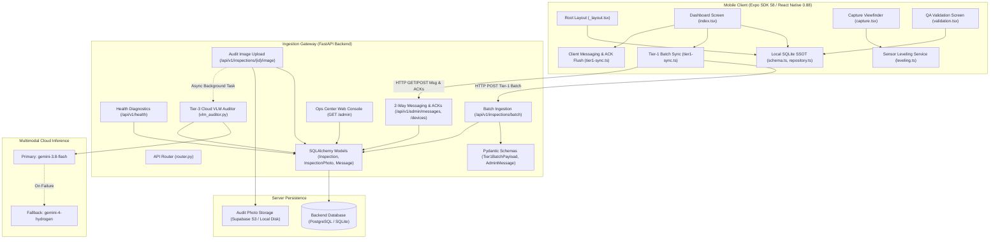
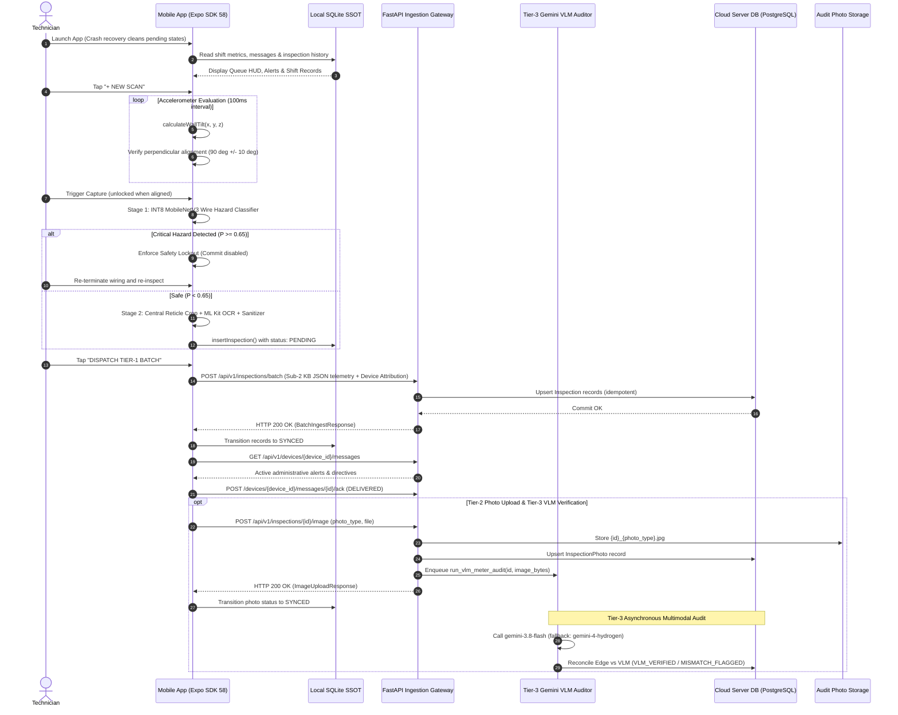

# Novo

Offline-first smart meter inspection and edge quality assurance platform. The system comprises an Expo mobile field application with local SQLite persistence and a FastAPI ingestion gateway for cellular telemetry batching, audit photo storage, Tier-3 asynchronous Cloud Vision-Language Model (VLM) second-verification, and two-way administrative field messaging with idempotent acknowledgments.

## Architecture



## Data Flow & Multi-Tier Verification Pipeline



## System Components

### 1. Mobile Client (`src/`)
- **Local SQLite SSOT** (`src/core/db/`): Configured with WAL journal mode (`PRAGMA journal_mode = WAL`), live schema migrations, and automated startup crash recovery resetting interrupted `SYNCING` and `PROCESSING` records.
- **Hardware-Sensor Leveling** (`src/services/sensor/leveling.ts`): Computes handset tilt from vertical normal ($\theta = \arctan(Z / \sqrt{X^2+Y^2}) \times 180/\pi$), locking capture to an angular window of $90^\circ \pm 10^\circ$ ($\theta \le 20^\circ$) to eliminate specular sun glare.
- **Stage 1 INT8 Safety Interlock** (`src/services/inference/meter-inference.ts`): $1.24\text{~MB}$ INT8 quantized MobileNetV3 wire-hazard classifier executing in $24.34\text{~ms}$ on edge CPUs, halting OCR and enforcing job lockout when $P_{\text{hazard}} \ge 0.65$.
- **Stage 2 Sim-to-Real Hybrid OCR**: Reticle cropping paired with a deterministic 7-segment character sanitization lookup automaton and bounding box height-ratio decimal inference, achieving zero silent misreads within a $4.59\text{~MB}$ peak heap footprint.
- **Tier-1 Batch Sync** (`src/services/sync/tier1-sync.ts`): Dispatches offline telemetry batches ($<2\text{~KB}$ per 15 records) with exponential backoff and random jitter.
- **Two-Way Messaging Client**: Polls administrative broadcasts and direct technician alerts, storing them in local SQLite (`client_messages`), and dispatches idempotent acknowledgments (`pending_message_acks`).
- **Shift Dashboard** (`src/app/index.tsx`): Real-time offline queue metrics HUD, administrative directive banners, and runtime gateway configuration.

### 2. Ingestion Gateway & Cloud Infrastructure (`backend/`)
- **FastAPI Asynchronous Gateway** (`backend/app/main.py`): High-throughput ASGI server with CORS middleware, lifespan bootstrapping, and structured `/api/v1` routes.
- **Telemetry Batch Ingestion** (`backend/app/api/v1/inspections.py`): Endpoint `/api/v1/inspections/batch` with full device attribution (`device_id`, `device_model`, `app_version`) and idempotent upsert logic.
- **Audit Image Ingestion** (`backend/app/api/v1/inspections.py`): Endpoint `/api/v1/inspections/{id}/image` accepting multipart forms across `CASING`, `TERMINAL_COVER`, `DISPLAY`, and `TAMPER_SEAL` photo types.
- **Tier-3 Cloud VLM Auditor** (`backend/app/services/vlm_auditor.py`): Asynchronous background verification microservice powered by the official Google GenAI SDK. Dispatches audit frames to `gemini-3.8-flash` with automatic fallback to `gemini-4-hydrogen`, reconciling physical display readings with edge OCR:
  - If edge reading was unreadable but VLM detects cumulative kWh with confidence $\ge 0.70$, automatically reconciles the register.
  - If discrepancy $> 1.0\text{~kWh}$, flags the inspection as `MISMATCH_FLAGGED` for supervisory human review.
- **Two-Way Administrative Messaging** (`backend/app/api/v1/messages.py`): Full dispatch engine supporting `BROADCAST` and targeted `DEVICE`/`TECHNICIAN` messages with priority tiers (`LOW`, `NORMAL`, `URGENT`) and idempotent delivery tracking.
- **Live Ops Center Web Console** (`GET /admin`): Integrated zero-build HTML/Tailwind web console featuring real-time inspection feeds, VLM audit tags, photo lightbox modals, and directive dispatching.
- **Database & Storage Layer**: SQLAlchemy models supporting local SQLite for offline development and Supabase PostgreSQL with connection pooling and S3-compatible bucket storage (`audit-images`) for production.
- **Zero-Trust Mesh Overlay**: Supports peer-to-peer WireGuard routing via Tailscale (`100.108.9.95:8000`) for private CGNAT access without public port forwarding.

## Getting Started

### Prerequisites
- Node.js (v18+) and pnpm
- Python (3.12+) and uv (or pip)
- (Optional) Gemini API Key for Tier-3 VLM verification (`GEMINI_API_KEY`)

### Mobile Application

```bash
# Install dependencies
pnpm install

# Start Metro bundler
pnpm start

# Run on Android or iOS
pnpm android
pnpm ios

# Code quality checks
pnpm lint
pnpm check
npx tsc --noEmit
```

### Ingestion Gateway

```bash
cd backend

# Create virtual environment and install dependencies
uv venv
uv pip install -r requirements.txt

# Configure environment variables
cp .env.example .env
# Edit .env with GEMINI_API_KEY, SUPABASE_URL, etc.

# Run development server
uv run uvicorn app.main:app --reload --host 0.0.0.0 --port 8000

# Open Admin Ops Center in browser
# http://localhost:8000/admin

# Run test suite
pytest tests
```
